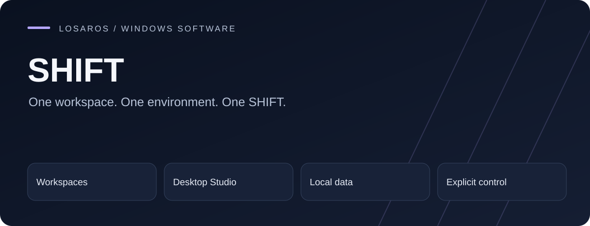
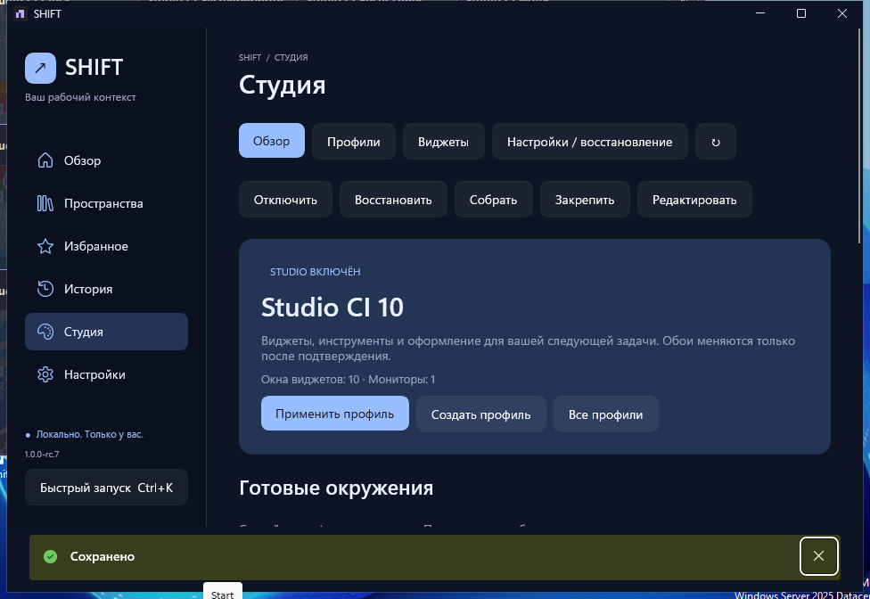
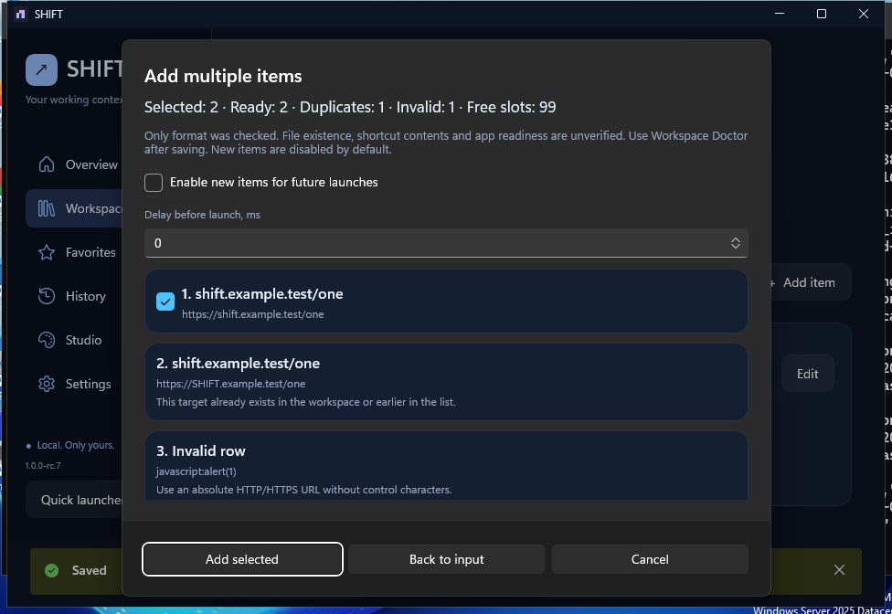
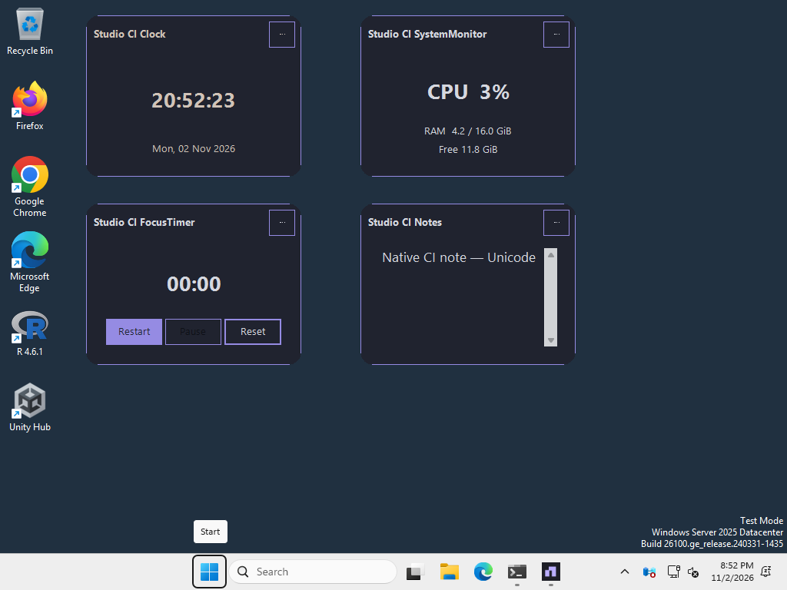
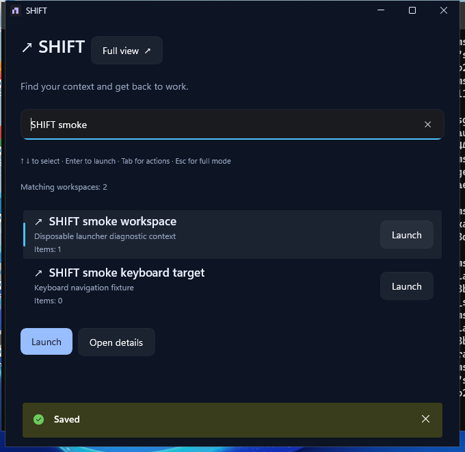

> **SHIFT 1.0.0-rc.8 is published:** [Feature guide](docs/RC8-GUIDE-EN.md) · [Windows validation and published SHA256](reports/RELEASE-PUBLICATION-2026-11-15.md) · [Genuine screens](docs/screenshots/rc8-main-candidate/README.md). Unsigned prerelease; complete physical Windows/DPI acceptance remains separate.

> **New in RC8:** launch policies with preflight, Quick Actions widgets and Recovery Center. [Guide](docs/RC8-GUIDE-EN.md) · [Implementation PR24](https://github.com/LosarOS/SHIFT/pull/24).

<div align="center">

> **SHIFT RC8:** [Windows prerelease](https://github.com/LosarOS/SHIFT/releases/tag/v1.0.0-rc.8) · [Русский быстрый старт](docs/QUICKSTART-RU.md) · [Validation report](reports/RELEASE-PUBLICATION-2026-11-15.md). Inspect launch policies, place reviewed Quick Actions and validate backups before a separate restore. Studio remains opt-in.
[Installer](https://github.com/LosarOS/SHIFT/releases/download/v1.0.0-rc.8/SHIFT-1.0.0-rc.8-win-x64-setup.exe) · [Portable](https://github.com/LosarOS/SHIFT/releases/download/v1.0.0-rc.8/SHIFT-1.0.0-rc.8-win-x64-portable.zip) · [SHA256](https://github.com/LosarOS/SHIFT/releases/download/v1.0.0-rc.8/SHA256SUMS.txt) · [Русский](README.md)



**A native, local-first workspace launcher for Windows.**

[Русский](README.md) · [Get started](docs/INSTALLATION.md) · [Architecture](docs/ARCHITECTURE.md) · [Roadmap](docs/ROADMAP.md) · [Validation](docs/VALIDATION.md) · [Audit](docs/AUDIT.md)

</div>

Bring your apps, folders, documents, projects and links into a workspace. Open your context in one action, see what happened, and move on with your day.

**1.0.0-rc.8 is available as an unsigned Windows prerelease.** [Windows downloads and checksums](https://github.com/LosarOS/SHIFT/releases). Native build, portable/installed UI Automation and installer preservation have passed; publication additionally verifies the extracted distribution and GitHub-downloaded bytes. Manual Windows 10/11, accessibility and DPI acceptance remain required before stable1.0. The exact verified state is recorded in [VALIDATION](docs/VALIDATION.md). A version number is not a substitute for testing.



Actual Windows runner capture with synthetic acceptance data. [Native RC7 views and exact limits](docs/screenshots/rc7/README.md).

## New in RC8

**Launch policies.** Choose a read-only preflight policy and whether errors stop dispatch or skip invalid items. Separately choose whether a dispatch failure stops remaining steps. Commands keep their usual consent flow.

**Quick Actions.** Put selected workspaces, folders, files and HTTP(S) links in a native desktop widget. Preview and import do not execute actions; workspace commands still require approval.

**Recovery Center.** Find a SQLite backup, inspect a private snapshot and review its contents before separately confirming restore. A full copy of external resources requires copying the entire data directory after Quit.

[RC8 guide](docs/RC8-GUIDE-EN.md) · [Actual new screens with provenance](docs/screenshots/rc8-main-candidate/README.md) · [Published build and exact verification limits](reports/RELEASE-PUBLICATION-2026-11-15.md).

## Included from RC7: review before dispatch

Add a list of paths or URLs, review duplicates and invalid rows, and append only selected entries. New items are disabled by default. The launch plan shows actual ordering, enabled/skipped steps, command shells and configured delay totals without starting anything. [Workspace guide in Russian](docs/WORKSPACE-PRODUCTIVITY-RU.md).

Studio saves layout changes per instance against acknowledged state. Newer editor geometry, hidden/replaced widgets and notes are protected; LastApplied metadata no longer causes configuration revision conflicts. **461 unique core tests** plus actual portable/installed RU/EN UI scenarios passed. [Evidence and remaining acceptance gates](reports/SHIFT-RC7-VALIDATION-RU.md).



## Workspaces for different days

| Workspace | What you can bring together |
| --- | --- |
| Development | IDE, working folder, docs, terminal and a calm Studio environment |
| Study | Documents, PDFs, notes and reference sites |
| Streaming | OBS, chat, dashboard and a separate widget profile |

You choose the applications and appearance. Examples do not install software or alter Windows automatically.

## Designed for your working day

- **Workspaces that stay yours.** Create, edit, clone, tag, search and favorite. Sort by recency, name or frequency of use.
- **One visible launch queue.** Set order and delays; disable optional steps; cancel remaining steps. Choose whether a dispatch failure continues or stops remaining steps.
- **Inspect before launching.** Workspace Doctor checks local paths, executable headers, URL format and shell availability without opening targets. Review warnings and jump directly to the item editor. Shortcut targets, arbitrary arguments and application readiness are explicitly unverified.
- **A compact launcher.** Press Ctrl+K in SHIFT or opt into Ctrl+Alt+Space. Search across names, descriptions and tags, select with arrow keys, review without launching or press Enter with the usual command consent.
- **History with useful detail.** Results per item, Unicode search, failure filtering, pagination, retry and local usage counts across the full database.
- **Control over executable actions.** Review and confirm commands on every launch. Importing a workspace never starts it.
- **Data without a service.** SQLite, versioned JSON import/export, online backups, validated restore with a safety backup and interrupted-run recovery.
- **Studio environments.** Opt-in visual profiles, reversible static wallpaper, Clock, System Monitor, Notes, Focus Timer and Quick Actions. Native windows, no Explorer injection.
- **Your environment, portable.** Share reviewed Studio configuration packs without wallpaper/paths/current notes. Export actual Notes as readable text; reuse full styles in Widget Lab with preview and cancel. [Guide in Russian](docs/STUDIO-SHARING-RU.md).
- **Windows at home.** Native WinUI controls, four palettes, RU/EN, tray, notifications, per-user startup and existing-instance activation.

No account, telemetry, paid API, backend, Docker or cloud dependency. Opening a site or app can of course let that site or app access the network.

## Interface in use

Real RC7 captures from a disposable Windows Server runner with synthetic data; these do not establish physical Windows 11/DPI acceptance.

| Workspace tools | Desktop environment |
| --- | --- |
|  |  |
|  |  |

## FAQ

**Do I need an account?** No. Workspaces, notes and appearance settings are local.

**Will SHIFT restore all tabs and windows?** No. It opens saved items; arbitrary session capture and third-party window layouts are future modules.

**Can I cancel a launch?** Yes, remaining steps can be cancelled. Apps already opened stay open.

**Why might Windows warn about the EXE?** Binaries are unsigned. Check the download source and SHA256; SmartScreen behavior is not certified.

## What “launch” means

Success means Windows accepted the request to open an item. SHIFT does not guarantee that another app is ready or that a shell command completed successfully. Cancelling does not close programs already opened.

This release launches saved workspaces. Capturing arbitrary open sessions, restoring window layouts and scheduling routines are [separate roadmap features](docs/ROADMAP.md).

## Build and run

Windows x64, .NET **10** SDK and Windows build tools. WinUI targets Windows 10 build 19041+; Windows 11 is the primary UX target. Windows 10 compatibility, clean-machine prerequisites and installer behavior must be checked in the release matrix.

```powershell
dotnet restore SHIFT.sln --locked-mode
dotnet test tests/Shift.Tests -c Release
dotnet run --project src/Shift.App -c Debug
```

For an IDE, use Visual Studio 2026 with .NET 10 and Windows development support. Core tests also run on Linux/macOS:

```sh
dotnet test tests/Shift.Tests -c Release
```

Create the Windows distribution with PowerShell 7 and Inno Setup 6:

```powershell
pwsh ./packaging/Build-Release.ps1 -Version 1.0.0-rc.8
```

The script runs locked restore, core tests, self-contained publish and UI Automation smoke, then creates a portable ZIP, per-user installer and SHA-256 checksums in `artifacts/`. Windows CI additionally tests the installed app and uninstall. The UI smoke includes an explicitly approved harmless command that writes a marker into its disposable test profile; it also verifies refusal does not execute it. Diagnostics and real-window screenshots are saved by CI; screenshots are genuine disposable Windows runner captures.

No signing key is included. Public downloads must state their signing and validation status. [Installation, data paths and recovery →](docs/INSTALLATION.md)

## Local data, explicit trust

Installed data: `%LOCALAPPDATA%\SHIFT`. Portable data: `data\` alongside `SHIFT.exe`, selected by `portable.flag`. Background serialization keeps SQLite work off the UI thread. Completed runs survive workspace deletion. Automatic backups retain the latest ten daily snapshots; manual backups are kept until you remove them.

Workspace files, backups and logs are **unencrypted**. They may reveal personal paths, document names or command text. Do not store passwords or tokens in launch arguments. Redact diagnostics before sharing them.

SHIFT is not a sandbox. Apps, shortcuts, documents through registered handlers and commands are executable trust decisions. Review imported items. See [SECURITY](SECURITY.md).

## Project map

```text
src/
  Shift.Domain/          Models, validation and usage records
  Shift.Application/     Launch orchestration, contracts and JSON transfer
  Shift.Infrastructure/  SQLite, background store, backup/restore, OS dispatch, IPC
  Shift.App/             WinUI shell, compact launcher, localization and OS integration
tests/Shift.Tests/       Core, persistence, restore and request-construction tests
packaging/               Portable / installer build and Windows UI smoke
.github/workflows/       Cross-platform core CI and Windows release checks
docs/                    Product, UX, architecture, roadmap and release evidence
```

[Product brief](docs/PRD.md) · [UX](docs/UX.md) · [Architecture](docs/ARCHITECTURE.md) · [QA checklist](docs/QA.md) · [Changelog](CHANGELOG.md) · [Release notes](docs/RELEASE_NOTES.md)

Contributions: [CONTRIBUTING](CONTRIBUTING.md). License: [MIT](LICENSE); dependencies retain their [own licenses](THIRD-PARTY-NOTICES.md).
