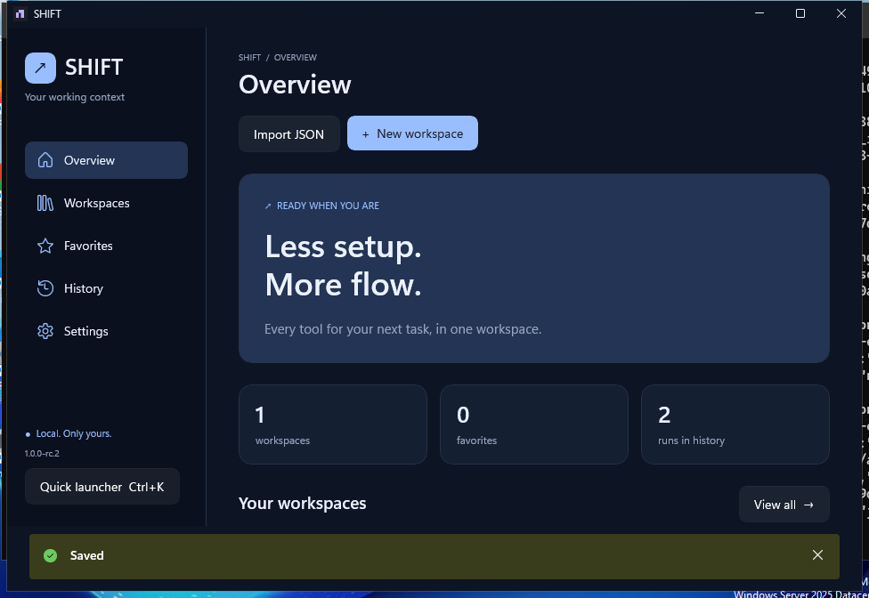

<div align="center">

> **SHIFT RC4:** [Windows prerelease](https://github.com/LosarOS/SHIFT/releases/tag/v1.0.0-rc.4) · [Русский быстрый старт](docs/QUICKSTART-RU.md) · [Validation report](reports/SHIFT-RC4-VALIDATION-RU.md). Quick Setup, starter environments, Russian Studio and atomic widget editing. Studio remains opt-in; physical Windows/accessibility limits are disclosed.
[Русский быстрый старт](docs/QUICKSTART-RU.md) · [RC4 engineering journal](reports/SHIFT-RC4-ENGINEERING-SESSION.md) · [Отчёт RC4](reports/SHIFT-RC4-VALIDATION-RU.md)


**A native, local-first workspace launcher for Windows.**

[Русский](README.ru.md) · [Get started](docs/INSTALLATION.md) · [Architecture](docs/ARCHITECTURE.md) · [Roadmap](docs/ROADMAP.md) · [Validation](docs/VALIDATION.md) · [Audit](docs/AUDIT.md)

</div>

Bring your apps, folders, documents, projects and links into a workspace. Open your context in one action, see what happened, and move on with your day.

**1.0.0-rc.4 is available as an unsigned Windows prerelease.** [Windows downloads and checksums](https://github.com/LosarOS/SHIFT/releases). Native build, portable/installed UI Automation and installer preservation have passed; publication additionally verifies the extracted distribution and GitHub-downloaded bytes. Manual Windows 10/11, accessibility and DPI acceptance remain required before stable1.0. The exact verified state is recorded in [VALIDATION](docs/VALIDATION.md). A version number is not a substitute for testing.



Actual Windows runner capture with synthetic acceptance data. [Doctor and other native views](docs/screenshots/rc2/README.md).

## Designed for your working day

- **Workspaces that stay yours.** Create, edit, clone, tag, search and favorite. Sort by recency, name or frequency of use.
- **One visible launch queue.** Set order and delays; disable optional steps; cancel remaining steps. One failure does not stop the other items.
- **Inspect before launching.** Workspace Doctor checks local paths, executable headers, URL format and shell availability without opening targets. Review warnings and jump directly to the item editor. Shortcut targets, arbitrary arguments and application readiness are explicitly unverified.
- **A compact launcher.** Press Ctrl+K in SHIFT or opt into the Ctrl+Alt+Space global shortcut. Search a workspace and press Enter.
- **History with useful detail.** Results per item, Unicode search, failure filtering, pagination, retry and local usage counts across the full database.
- **Control over executable actions.** Review and confirm commands on every launch. Importing a workspace never starts it.
- **Data without a service.** SQLite, versioned JSON import/export, online backups, validated restore with a safety backup and interrupted-run recovery.
- **Windows at home.** Native WinUI controls, four palettes, RU/EN, tray, notifications, per-user startup and existing-instance activation.

No account, telemetry, paid API, backend, Docker or cloud dependency. Opening a site or app can of course let that site or app access the network.

## What “launch” means

Success means Windows accepted the request to open an item. SHIFT does not guarantee that another app is ready or that a shell command completed successfully. Cancelling does not close programs already opened.

This release launches saved workspaces. Capturing arbitrary open sessions, restoring window layouts and scheduling routines are [separate roadmap features](docs/ROADMAP.md).

## Build and run

Windows x64, .NET **10** SDK and Windows build tools. WinUI targets Windows 10 build 19041+; Windows 11 is the primary UX target. Windows 10 compatibility, clean-machine prerequisites and installer behavior must be checked in the release matrix.

```powershell
dotnet restore SHIFT.sln --locked-mode
dotnet test tests/Shift.Tests -c Release
dotnet run --project src/Shift.App -c Debug
```

For an IDE, use Visual Studio 2026 with .NET 10 and Windows development support. Core tests also run on Linux/macOS:

```sh
dotnet test tests/Shift.Tests -c Release
```

Create the Windows distribution with PowerShell 7 and Inno Setup 6:

```powershell
pwsh ./packaging/Build-Release.ps1 -Version 1.0.0-rc.5
```

The script runs locked restore, core tests, self-contained publish and UI Automation smoke, then creates a portable ZIP, per-user installer and SHA-256 checksums in `artifacts/`. Windows CI additionally tests the installed app and uninstall. The UI smoke includes an explicitly approved harmless command that writes a marker into its disposable test profile; it also verifies refusal does not execute it. Diagnostics and real-window screenshots are saved by CI; screenshots are genuine disposable Windows runner captures.

No signing key is included. Public downloads must state their signing and validation status. [Installation, data paths and recovery →](docs/INSTALLATION.md)

## Local data, explicit trust

Installed data: `%LOCALAPPDATA%\SHIFT`. Portable data: `data\` alongside `SHIFT.exe`, selected by `portable.flag`. Background serialization keeps SQLite work off the UI thread. Completed runs survive workspace deletion. Automatic backups retain the latest ten daily snapshots; manual backups are kept until you remove them.

Workspace files, backups and logs are **unencrypted**. They may reveal personal paths, document names or command text. Do not store passwords or tokens in launch arguments. Redact diagnostics before sharing them.

SHIFT is not a sandbox. Apps, shortcuts, documents through registered handlers and commands are executable trust decisions. Review imported items. See [SECURITY](SECURITY.md).

## Project map

```text
src/
  Shift.Domain/          Models, validation and usage records
  Shift.Application/     Launch orchestration, contracts and JSON transfer
  Shift.Infrastructure/  SQLite, background store, backup/restore, OS dispatch, IPC
  Shift.App/             WinUI shell, compact launcher, localization and OS integration
tests/Shift.Tests/       Core, persistence, restore and request-construction tests
packaging/               Portable / installer build and Windows UI smoke
.github/workflows/       Cross-platform core CI and Windows release checks
docs/                    Product, UX, architecture, roadmap and release evidence
```

[Product brief](docs/PRD.md) · [UX](docs/UX.md) · [Architecture](docs/ARCHITECTURE.md) · [QA checklist](docs/QA.md) · [Changelog](CHANGELOG.md) · [Release notes](docs/RELEASE_NOTES.md)

Contributions: [CONTRIBUTING](CONTRIBUTING.md). License: [MIT](LICENSE); dependencies retain their [own licenses](THIRD-PARTY-NOTICES.md).
