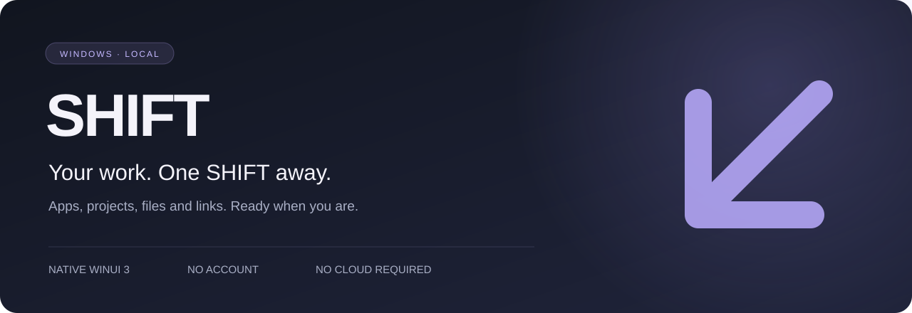

# SHIFT ↗

[English](README.md)



**Меньше подготовки. Больше потока.** Локальный менеджер рабочих пространств для Windows 10/11 x64.

Соберите приложения, папки, файлы, ссылки и команды в пространство под задачу. Запускайте по порядку, смотрите результаты, возвращайтесь к следующему контексту одним действием. Без аккаунта, облака, телеметрии и платных API.

> **1.0.0-rc.1 — кандидат в релиз.** Код MVP и сборочный pipeline подготовлены. Windows runtime и установщик требуют проверки перед stable 1.0. Результаты проверок и оставшиеся release gates: [VALIDATION](docs/VALIDATION.md).

## Реализовано

- Компактный launcher, Ctrl+K и опциональный Ctrl+Alt+Space; активация уже работающего экземпляра.
- Пагинация и поиск истории, фильтр ошибок, повтор запуска, статистика всей базы, сортировка и фильтр тегов.
- Фоновая сериализация SQLite и восстановление из проверенного backup с предварительной копией текущих данных.

- Пространства: создание, редактирование, удаление с подтверждением, копирование, избранное, теги, поиск.
- Элементы: `.exe` / `.lnk`, папки, документы, HTTP(S), PowerShell / cmd; параметры приложений, рабочая папка, задержка, заметка, включение и порядок.
- Последовательная очередь: pending → running → success / failed / skipped; отмена, отдельные ошибки, история и восстановление отметок после сбоя.
- Перед командами — просмотр и подтверждение **при каждом запуске**. Импорт ничего не запускает.
- WinUI 3: Overview, Workspaces, Favorites, History, Settings, onboarding с примером; RU / EN; Dark, Light, Midnight, Forest.
- Трей, уведомления в трее, автозапуск текущего пользователя (установленная версия).
- SQLite, JSON import/export, согласованные online backup, ежедневные резервные копии при открытии (последние 10 автоматических копий).
- Portable и per-user installer: сценарий сборки, Inno Setup, Windows CI, SHA-256.

**Успех в очереди означает передачу запроса Windows**, а не готовность запущенного приложения. SHIFT не закрывает программы при отмене и не восстанавливает окна или внутренние вкладки приложения. Несколько URL открываются отдельными запросами в браузере по умолчанию. Снятие сессии и layout presets запланированы далее.

## Быстрый старт разработки

Windows 10 **2004 / build 19041+** или Windows 11 x64. Для основной QA-матрицы: Windows 10 22H2 и Windows 11. Windows 10 уже вне стандартной поддержки Microsoft; SHIFT не меняет этот статус ОС.

Установите .NET 10 SDK (10.0.100+; последняя 10.0 feature band разрешена `global.json`). Для работы в IDE используйте Visual Studio 2026 с поддержкой .NET 10, Windows SDK и workload разработки Windows-приложений. Для командной сборки WinUI нужны Windows SDK / Build Tools, зависимости также приходят из NuGet.

```powershell
dotnet restore SHIFT.sln --locked-mode
dotnet test tests/Shift.Tests -c Release
dotnet build src/Shift.App -c Debug
dotnet run --project src/Shift.App -c Debug
```

На Linux/macOS проверяется ядро:

```sh
dotnet test tests/Shift.Tests -c Release
```

Windows-приложение написано на C# с программным построением WinUI visual tree. Это настоящие WinUI-контролы, без WebView / браузерного runtime. Страницы разделены на partial-файлы; состояние и операции находятся в `ShellViewModel`, запуск — в Application.

## Сборки

На Windows с Inno Setup 6:

```powershell
pwsh ./packaging/Build-Release.ps1 -Version 1.0.0-rc.1
```

Скрипт также выполняет UI Automation smoke на временном portable-профиле: onboarding, создание пространства, сохранение и повторное построение настроек. Результат в `artifacts/`: portable ZIP (с .NET и Windows App SDK runtime), installer EXE, `SHA256SUMS.txt`. Скрипт не подписывает бинарники. На tag `v*` GitHub Actions создаёт **draft release**, который следует опубликовать только после ручной QA. В этом репозитории нет готового проверенного EXE; его следует получить на Windows.

[Установка, portable, перенос и восстановление данных →](docs/INSTALLATION.md)

## Структура

```text
src/
  Shift.Domain/          Модели и инварианты
  Shift.Application/     Contracts, очередь, перенос JSON
  Shift.Infrastructure/  SQLite, Windows launcher, файловые логи
  Shift.App/             WinUI, view model, локализация, интеграция с Windows
    Services/
    Views/
tests/Shift.Tests/       Unit + SQLite integration tests
packaging/               Portable / Inno Setup
docs/                    Продукт, архитектура, UX, roadmap, QA
.github/workflows/       Проверки и Windows release build
```

## Документация

- [PRD, personas и критерии MVP](docs/PRD.md)
- [Архитектура, данные и contracts](docs/ARCHITECTURE.md)
- [UX и navigation map](docs/UX.md)
- [План итераций и roadmap](docs/ROADMAP.md)
- [QA и release checklist](docs/QA.md)
- [Фактическая валидация](docs/VALIDATION.md)
- [Release notes](docs/RELEASE_NOTES.md) · [Changelog](CHANGELOG.md)
- [Вклад в проект](CONTRIBUTING.md) · [Безопасность](SECURITY.md) · [Сторонние компоненты](THIRD-PARTY-NOTICES.md)

## Приватность и доверие

Данные: `%LOCALAPPDATA%\SHIFT`; portable: `data\` рядом с EXE. Импорт, экспорт и backup не зашифрованы. Не сохраняйте пароли в аргументах или командах. Логи не записывают целиком команды и targets специально, но сообщения ОС об ошибках могут содержать локальные пути. SHIFT не требует прав администратора. Запущенные программы и сайты сами могут обращаться в сеть.

Workspace — доверенный сценарий запуска, **не sandbox**. `.lnk`, `.exe`, документы через приложения по умолчанию и команды способны выполнять код. Не импортируйте чужие сценарии без проверки. Для команд есть отдельное обязательное подтверждение; это не анализ безопасности содержимого.

MIT · SHIFT contributors
