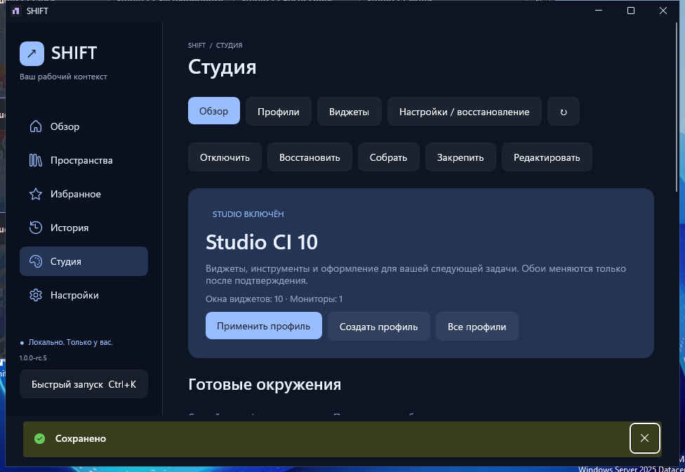

> **Известная ошибка RC5:** переносы строк в Notes после редактора WinUI могут отображаться слитно в desktop-виджете. Подтверждено на публичных байтах; исправление RC6 проверяется отдельно. [Evidence](reports/evidence/rc5/native-notes-newline-baseline.json).

# SHIFT ↗

[English](README.md) · [Быстрый старт](docs/QUICKSTART-RU.md) · [Перенос профилей и заметок](docs/STUDIO-SHARING-RU.md)


**Одно пространство. Своё окружение. Один SHIFT.**

SHIFT — нативное приложение для Windows 10/11 x64, которое собирает приложения, папки, файлы, ссылки и команды в рабочие пространства. Запускайте нужный набор по порядку и отдельно применяйте своё оформление Studio: обои, часы, системный монитор, заметки и таймер фокусировки.

Данные остаются на компьютере. Без обязательной регистрации, облака, телеметрии и платных API.

> **Выпущен [SHIFT 1.0.0-rc.5](https://github.com/LosarOS/SHIFT/releases/tag/v1.0.0-rc.5).** [Установщик](https://github.com/LosarOS/SHIFT/releases/download/v1.0.0-rc.5/SHIFT-1.0.0-rc.5-win-x64-setup.exe) · [Portable](https://github.com/LosarOS/SHIFT/releases/download/v1.0.0-rc.5/SHIFT-1.0.0-rc.5-win-x64-portable.zip) · [SHA256](https://github.com/LosarOS/SHIFT/releases/download/v1.0.0-rc.5/SHA256SUMS.txt). **375 тестов**, native Windows UIA и installer preservation прошли; публичные файлы повторно скачаны и сверены. [Отчёт с доказательствами](reports/SHIFT-RC5-VALIDATION-RU.md). Неподписанный prerelease; физическая Windows10/11, DPI и accessibility ещё требуют приёмки. Stable1.0 не объявлен.



[Реальные снимки RC5](docs/screenshots/rc5/README.md) с синтетическими тестовыми данными; это не концепт-рендеры.

## Что умеет SHIFT

- **Рабочие пространства.** Создание, редактирование, копирование, избранное, теги, поиск и сортировка по реальной истории использования. Мастер «Создать из приложений» помогает выбрать локальные ярлыки и проверить порядок до сохранения.
- **Понятный запуск.** Порядок, задержки, включение отдельных элементов, статусы и отмена оставшейся очереди. Команды требуют просмотра и отдельного подтверждения при каждом запуске.
- **Проверка пространства.** Workspace Doctor проверяет локальные пути, формат URL и доступность оболочки без запуска приложений, команд и скрытых сетевых запросов. Это предварительная диагностика, а не гарантия готовности стороннего приложения.
- **Быстрое переключение.** Ctrl+K открывает компактный лаунчер; глобальный Ctrl+Alt+Space включается отдельно. В RC5 поиск понимает несколько слов из имени, описания и тегов; выбранную строку можно открыть через «Открыть детали» без запуска.
- **История и данные.** Результаты каждого элемента, поиск, фильтр ошибок, страницы истории и повтор по текущему содержимому пространства. SQLite, JSON пространства, согласованный backup и проверка восстановления.
- **Studio.** Независимые визуальные профили, явная связь с пространствами, статичные обои по мониторам, восстановление предыдущего оформления с проверкой конфликтов. Studio выключен по умолчанию.
- **Четыре виджета.** Настоящее локальное время, ЦП/ОЗУ, заметки с автосохранением и таймер фокусировки. Отдельные управляемые окна, без внедрения в Explorer и прав администратора. Мастерская позволяет редактировать черновик и смотреть отдельный предпросмотр до сохранения.
- **Готовые окружения.** «Разработка», «Стриминг» и «Фокус» создают наборы виджетов без автоматического изменения Windows. Сохраняются темы Dark, Light, Midnight и Forest, а также RU/EN.

## Новое в RC5

**Переносимые профили Studio.** Экспортируйте набор виджетов с оформлением и относительным расположением в `.shiftstudio.json`. Импорт проверяет файл, показывает состав, позволяет переименовать профиль и создаёт отдельную копию одной транзакцией. Применение остаётся явным действием. Обои, локальные пути, привязки к пространствам, текущие заметки и таймеры в пакет не входят.

**Экспорт заметок профиля.** «Сохранить заметки» собирает текущий текст открытых виджетов выбранного профиля и сохранённые скрытые заметки в читаемый UTF-8 файл. Разные экземпляры одного шаблона сохраняют свой текст. Перед передачей доступен просмотр и копирование. Неоткрытые recovery-черновики нужно восстанавливать через меню виджета отдельно.

**Своё оформление.** Возьмите полный стиль другого виджета в мастерской: палитру, шрифт, прозрачность, рамку и тень. Содержимое не копируется. Изменения остаются черновиком; отмена ничего не сохраняет. Исправлены меню после Escape и потеря строк в многострочных редакторах.

**Управление с клавиатуры.** Компактный лаунчер использует настоящий список с выделением и доступными именами действий. В окне виджета: Ctrl+S — сохранить, Ctrl+Shift+S — сохранить текст заметки в файл, Shift+F10 — открыть меню. Для конфликта таймера можно явно выбрать состояние окна или базы.

[Как переносить оформление и сохранять заметки →](docs/STUDIO-SHARING-RU.md)

**Success означает передачу запроса Windows**, а не готовность запущенной программы или успешное завершение команды. Отмена не закрывает уже запущенные приложения. SHIFT пока не захватывает произвольную открытую сессию, вкладки браузера или расположение сторонних окон.

## Установка и обновление

Требуется Windows x64; WinUI нацелен на Windows 10 build 19041+ и Windows 11. Полная физическая приёмка Windows 10/11, смешанных DPI, нескольких мониторов и специальных возможностей остаётся отдельной релизной проверкой. CI на Windows Server её не заменяет.

Установщик работает для текущего пользователя. Portable нужно полностью распаковать в папку с правом записи; `portable.flag` должен оставаться рядом с `SHIFT.exe`. Для обновления сначала выйдите из SHIFT через трей и сохраните **всю папку данных**. Неподписанные EXE могут вызвать предупреждение SmartScreen.

[Подробная установка и восстановление данных](docs/INSTALLATION.md) · [Быстрый старт на русском](docs/QUICKSTART-RU.md)

## Разработка и сборка

Стек: C#, .NET 10, WinUI 3 / Windows App SDK, SQLite, PowerShell 7 и Inno Setup 6. Основное окно использует WinUI; лёгкий native-host виджетов работает в том же процессе через управляемые Windows-окна. Браузерный runtime для простых виджетов не нужен.

На Windows с .NET 10 SDK, Windows SDK / Build Tools и поддержкой Windows-разработки:

```powershell
dotnet restore SHIFT.sln --locked-mode
dotnet test tests/Shift.Tests -c Release --no-restore
dotnet run --project src/Shift.App -c Debug
```

В IDE используйте Visual Studio с поддержкой .NET 10 и Windows-разработки. Linux/macOS подходят для тестов ядра; их успешный запуск не подтверждает работоспособность Windows EXE:

```sh
dotnet test tests/Shift.Tests -c Release
```

Windows-дистрибутив собирается штатным сценарием:

```powershell
pwsh ./packaging/Build-Release.ps1 -Version 1.0.0-rc.6
```

Сценарий проверяет locked restore, тесты ядра, self-contained publish, ресурсы WinUI и извлечённый portable. Windows pipeline дополнительно проверяет native UI, установку, повторную установку, удаление и сохранность данных. Результаты каждого выпуска отражаются в его evidence и validation report. Публикация требует прохождения соответствующих gates и сверки скачанных бинарников; одного успешного compile недостаточно.

```text
src/
  Shift.Domain/          Модели и инварианты
  Shift.Application/     Запуск, профили, перенос и contracts
  Shift.Infrastructure/  SQLite, Windows API, локальные файлы и логи
  Shift.App/             WinUI, локализация, мастерская и native-host виджетов
tests/Shift.Tests/       Unit и integration tests
packaging/               Windows build, portable, installer и smoke
.github/workflows/       Cross-platform CI и Windows release pipeline
docs/                    Продукт, архитектура, инструкции и QA
reports/                 Фактические результаты инженерных сессий
```

## Приватность и восстановление

Установленная версия хранит данные в `%LOCALAPPDATA%\SHIFT`; portable — в `data\` рядом с EXE. SQLite, JSON, текстовые экспорты, буфер обмена и backup не зашифрованы. Названия, описания, заметки, пути и аргументы могут содержать личную информацию — просматривайте файл перед передачей и не храните секреты в командах.

Пакет профиля — способ перенести оформление, **не полная резервная копия**. SQLite backup не содержит сами файлы обоев и локальные recovery-черновики. Для полной копии выйдите из приложения и сохраните каталог данных целиком, включая `Studio/Images`, `Studio/RecoveryNotes` и `migration-backups`.

Команды, `.exe`, ярлыки и документы через системные обработчики — доверенные действия с пользовательскими правами. SHIFT не является sandbox. Импорт ничего не запускает автоматически. Studio не меняет Explorer, не требует elevation и не меняет системные политики. Статичные обои применяются с подтверждением; Spotlight и слайд-шоу не поддерживаются. Acrylic/Mica используют явно обозначенный fallback, без обещания настоящего стекла.

[Безопасность](SECURITY.md) · [Архитектура](docs/ARCHITECTURE.md) · [Roadmap](docs/ROADMAP.md) · [Фактическая валидация](docs/VALIDATION.md) · [Журнал RC5](reports/SHIFT-RC5-ENGINEERING-SESSION.md) · [Changelog](CHANGELOG.md)

MIT · SHIFT contributors
