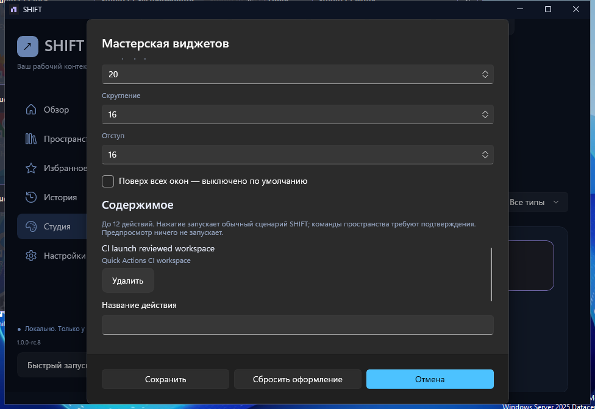

# SHIFT RC8: launch policies, Quick Actions and Recovery Center

Candidate guide; published RC7 binaries do not contain these features. See [PR24](https://github.com/LosarOS/SHIFT/pull/24) and the engineering evidence before choosing a build.

Open a workspace and choose **Launch scenario**. Preflight can be off, informational, stop on errors, or skip errors. A separate setting controls whether a dispatch failure stops remaining steps. Saving does not launch anything. Warnings and unknown observations are not readiness guarantees; cancellation does not close apps already opened. Commands still require consent. A workspace stopped before any dispatch does not automatically apply its linked Studio profile. Policies are local to workspace IDs and are not inherited by clones/imports.

In Studio Widget Lab, choose **Quick actions**, add up to12 titled saved-workspace, folder, file or HTTP(S) actions, save and place the widget in a profile. Preview never executes actions. Workspace buttons use the current saved configuration and normal consent. No arbitrary shell field is accepted. Actions do not start during another launch or modal dialog. Profile packs exclude local action destinations; individual definition exports may include paths/URLs/IDs, so review them before sharing.

**Settings → Recovery Center** lists backups and supports Browse, Validate and preview. Inspection uses a private consistent SQLite snapshot. Restore is separate, revalidates and preserves the old live database as a safety backup. It does not launch apps or change wallpaper.

SQLite backups do not include wallpaper files or local recovery drafts. For a full copy, Quit and copy the whole data directory including Studio/Images, Studio/RecoveryNotes and migration-backups. Schema3 migrates transactionally with backup. To downgrade, Quit, preserve the current directory and restore the previous full data directory for RC7; never edit user_version by hand.

Unsigned candidate; physical Windows10/11, DPI/monitor, accessibility and sleep/RDP acceptance remain separate. Full resource-bundle restore and arbitrary third-party window restoration are outside RC8.

## Candidate evidence

Source `a5effcdcc4861ff099636be7782dd5155a029671`:514core tests passed on the canonical Windows runner,0failed/0skipped. Actual portable/installed policies, inspection, Quick Actions, schema2→3 migration and old RC7 refusal were retained. [Bytes, hashes and gates](../reports/evidence/rc8-main-candidate/README.md) · [genuine new captures](screenshots/rc8-main-candidate/README.md). Native inspection is not full-resource Restore; physical Windows/DPI remains separate. Publication still needs owner approval.

The image is scrolled to action content, not the complete editor or full accessibility acceptance.
