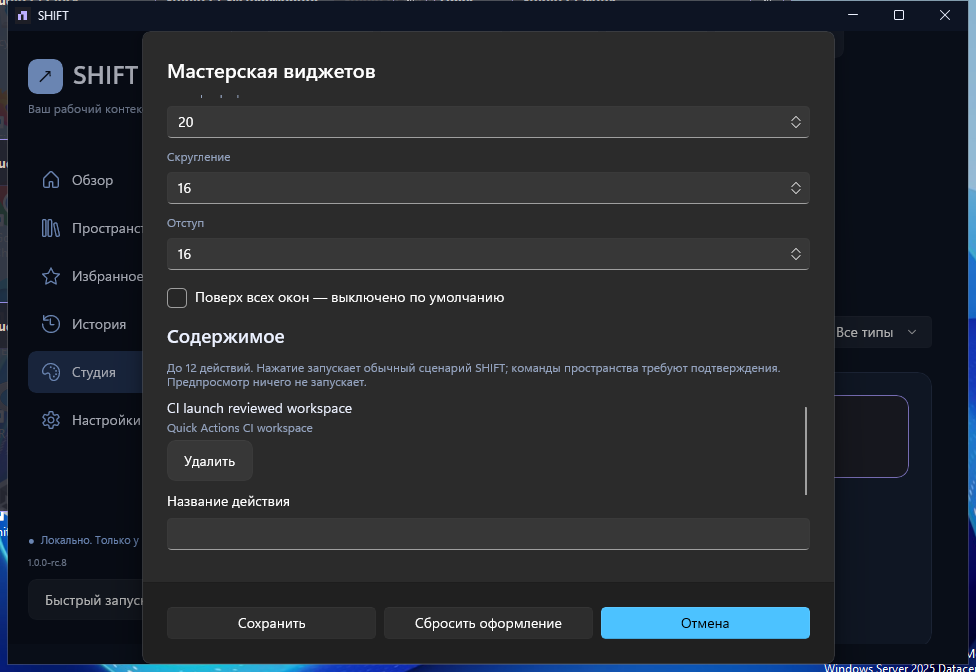

# SHIFT RC8: сценарии, быстрые действия и восстановление

Руководство опубликованного [SHIFT 1.0.0-rc.8](https://github.com/LosarOS/SHIFT/releases/tag/v1.0.0-rc.8). [Свежая Windows-сборка, публичные файлы и SHA256](../reports/RELEASE-PUBLICATION-2026-11-15.md). Ниже отдельно сохранены доказательства предварительного кандидата; его хеши не выдаются за хеши опубликованной пересборки.

## Проверка этого кандидата

Source `a5effcdcc4861ff099636be7782dd5155a029671`:514core-тестов прошли на canonical Windows runner,0failed/0skipped. Реальные portable/installed сценарии, inspection, Quick Actions, schema2→3 и защитный отказ старой RC7 зафиксированы отдельно. [Байты, хеши и gates](../reports/evidence/rc8-main-candidate/README.md) · [новые настоящие экраны](screenshots/rc8-main-candidate/README.md). Полная физическая Windows/DPI и ресурсный restore не объявлены проверенными. Опубликованная пересборка проверена отдельно — см. отчёт публикации выше.

Кадр прокручен к содержимому действий; это не весь редактор и не свидетельство полной accessibility-приёмки.

## Сценарий запуска

Откройте пространство → «Сценарий запуска». Выберите предварительную проверку: выключено, продолжить с результатами, остановить при ошибках или пропустить ошибочные элементы. Отдельно задайте, продолжать ли оставшуюся очередь после отказа Windows открыть элемент. Сохранение ничего не запускает.

Проверка читает локальные сведения и формат, не подтверждает готовность стороннего приложения. Правила остановки/пропуска относятся к Error; Warning и Unknown не становятся гарантией безопасности. Остановка не закрывает уже открытые программы; повтора dispatch нет. Команды сохраняют отдельное согласие. Если preflight остановил всё до первого dispatch, связанное оформление Studio не применяется.

Настройка локальна для ID пространства. Импорт/клонирование создаёт другое ID и не наследует сценарий. Полная копия базы сохраняет сценарии как пользовательские настройки.

## Quick Actions

В Studio → «Мастерская виджетов» выберите «Быстрые действия». Добавьте до 12 названных действий: сохранённое пространство, папка, файл или HTTP(S). Настройте оформление, сохраните определение и разместите экземпляр в профиле. Preview не выполняет действия.

Нажатие пространства использует актуальный сохранённый состав и обычный consent flow. Файл/папка/URL проходят существующий запуск SHIFT. Произвольного shell внутри действия нет. Пока открыт диалог или идёт запуск, новое действие не запускается.

Пакет профиля Studio исключает локальные назначения: после переноса настройте их заново. Экспорт отдельного определения виджета может содержать выбранные пути/URL/ID — проверьте его перед передачей. Импорт ничего не выполняет.

## Центр восстановления

«Настройки» → «Центр восстановления»: выберите найденную копию или .db через «Обзор», нажмите «Проверить и просмотреть». Проверка работает с приватным SQLite-снимком; рабочая база не заменяется. Сводка показывает схему и количество пространств, запусков и Studio-объектов.

Восстановление — отдельное подтверждение и повторная проверка; прежняя рабочая база сохраняется safety-копией. Непроверенная копия не может быть восстановлена из этого диалога. Проверка не запускает приложения и не применяет обои.

**SQLite backup не содержит файлы обоев и локальные recovery drafts.** Для полной копии: Quit и копия всего каталога данных, включая Studio/Images, Studio/RecoveryNotes и migration-backups.

## Обновление и возврат

RC8 использует schema3. Миграция создаёт проверяемую предмиграционную копию и выполняется транзакционно. Для возврата к RC7: Quit, сохраните текущую папку отдельно и восстановите старую полную папку данных для старой версии. Не изменяйте user_version вручную. Старое приложение должно отказать в открытии v3.

Бинарники unsigned. Windows Server CI не заменяет физическую Windows10/11, DPI/мониторы, Narrator и sleep/RDP. Полная ресурсная архивация и восстановление любых сторонних окон в RC8 не реализованы.
