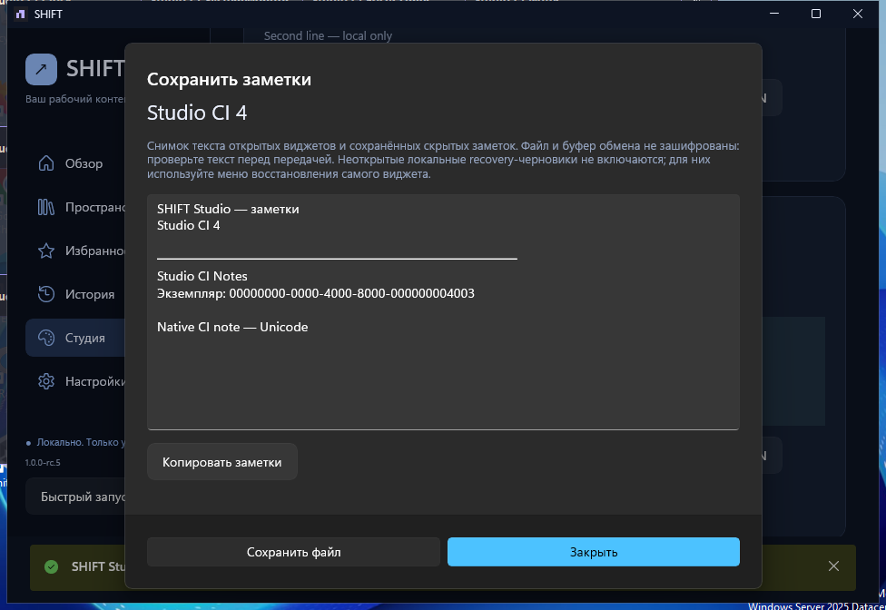

# RC5 — настоящие снимки Windows-приложения

Источник: [tag workflow40968079932](https://github.com/LosarOS/SHIFT/actions/runs/40968079932), binary/tag source `176c27040929c37058354e35aa147f5634a204ec`. Disposable **Windows Server2025 x64, один виртуальный монитор**, синтетические acceptance-данные. Это не физическая приёмка Windows11 и не рекламные макеты.

Изображения скопированы **без изменения байтов** из [публичного UI evidence ZIP](https://github.com/LosarOS/SHIFT/releases/download/v1.0.0-rc.5/SHIFT-Windows-UI-Evidence.zip). [Manifest с исходными именами и SHA256](source-manifest.json). Оригинальный архив содержит36кадров, в том числе диалоги настройки мониторов, properties и recovery.

| Кадр | Что показывает |
| --- | --- |
| [Studio Overview](studio-overview.png) | Русская оболочка и активный синтетический профиль |
| [Desktop Profiles](studio-profiles.png) | Карточки, действия и многострочные описания; английский этап smoke |
| [Widget Gallery](studio-gallery.png) | Русские виды виджетов, поиск и добавление |
| [Widget Lab](studio-widget-lab.png) | Русский property editor, draft/cancel; намеренно предельный fixture custom font32/padding64/border8, не рекомендуемая тема |
| [Desktop widgets](desktop-widgets.png) | Четыре настоящих окна: время, реальные CPU/RAM, завершённый таймер и сохранённая Notes |
| [Profile export](profile-export.png) | Русский JSON review и выключенный по умолчанию InitialNotes opt-in |
| [Profile import](profile-import.png) | Русский review до отмены: состав, переносимые позиции и предупреждения |
| [Notes export](notes-export.png) | Настоящий многострочный снимок с Unicode-текстом |
| [Compact Launcher](compact-launcher.png) | Реальное выделение, поиск и действия Launch/Review; английский этап smoke |

Фоновый Windows watermark и границы runner desktop оставлены как в оригинале. Весь архив также сохраняет stress-кадры с10окнами поверх основной оболочки: UIA может нажать кнопку фонового окна без обычного пользовательского переключения фокуса. Эти кадры не выдаются за чистые продуктовые презентации или доказательство удобства всех конфигураций.

[Фактическая валидация и ограничения](../../../reports/SHIFT-RC5-VALIDATION-RU.md) · [Ручной протокол](../../studio/RC5-MANUAL-ACCEPTANCE-RU.md).
