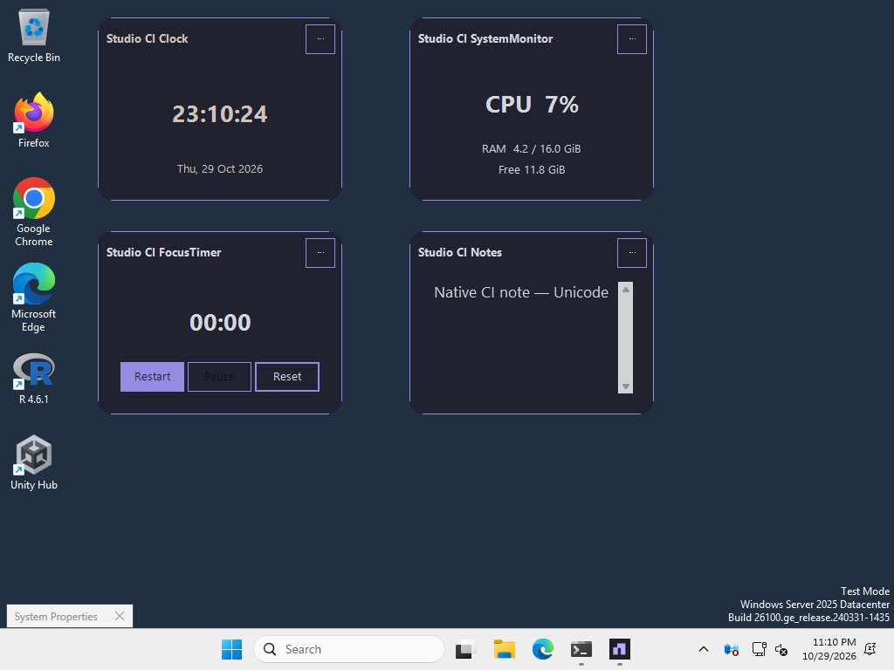
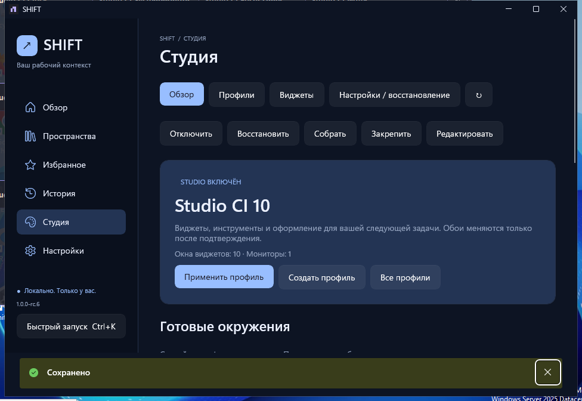

# RC6 — реальные Windows-снимки

[Tagged workflow](https://github.com/LosarOS/SHIFT/actions/runs/40970869902), source `de8e744d6993b3293b55ed56675cb6472ef68fab`. Disposable Windows Server2025 x64, один виртуальный монитор; синтетические тестовые данные. Это не физическая приёмка Windows11/DPI/accessibility.

Кадры скопированы **без изменения байтов** из [публичного архива](https://github.com/LosarOS/SHIFT/releases/download/v1.0.0-rc.6/SHIFT-Windows-UI-Evidence.zip) с 37PNG. [Manifest с SHA256](source-manifest.json). Оригинальные Windows watermark и границы runner desktop сохранены.

- [Studio Overview](studio-overview.png) — русская оболочка, реальная версия RC6.
- [Desktop widgets](desktop-widgets.png) — четыре настоящих окна, реальные время/CPU/RAM, таймер и Notes.
- [Native multiline Notes](native-multiline-notes.png) — намеренный stress-кадр 10 окон поверх Settings: в Notes видны отдельные строки. Это контекст диагностики, не чистая презентация Settings. [HWND/line evidence](../../../reports/evidence/rc6/native-notes-newline-proof.json) независимо проверяет реальное отображение.
- [Notes export](notes-export.png) — полный текст в русском предпросмотре.
- [Widget Gallery](studio-gallery.png) — русские виды и поиск.
- [Compact Launcher](compact-launcher.png) — настоящее выделение и действия; английский этап smoke.

В полном архиве также есть profile import/export, properties, Widget Lab, recovery и installed core views. Stress-кадры 10 окон/предельных стилей не выдаются за рекомендуемую тему или ручную usability-приёмку. [Финальный отчёт](../../../reports/SHIFT-RC6-VALIDATION-RU.md).
